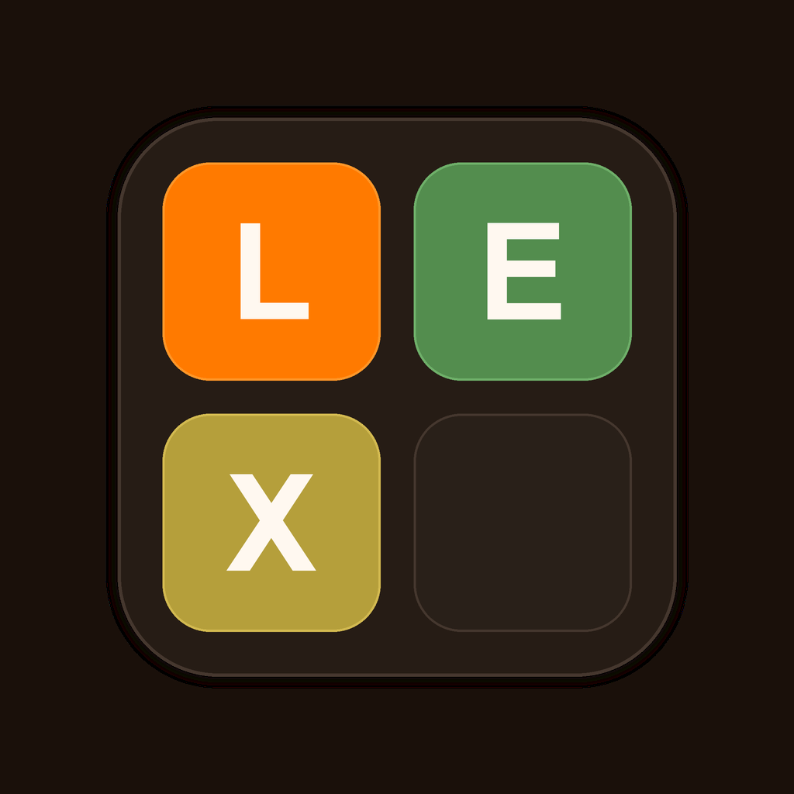
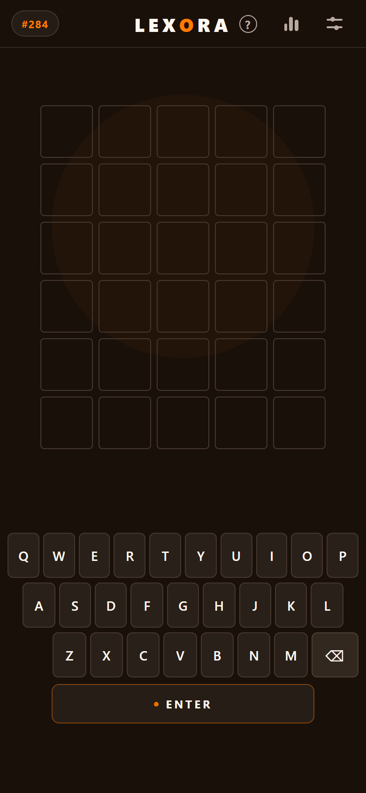
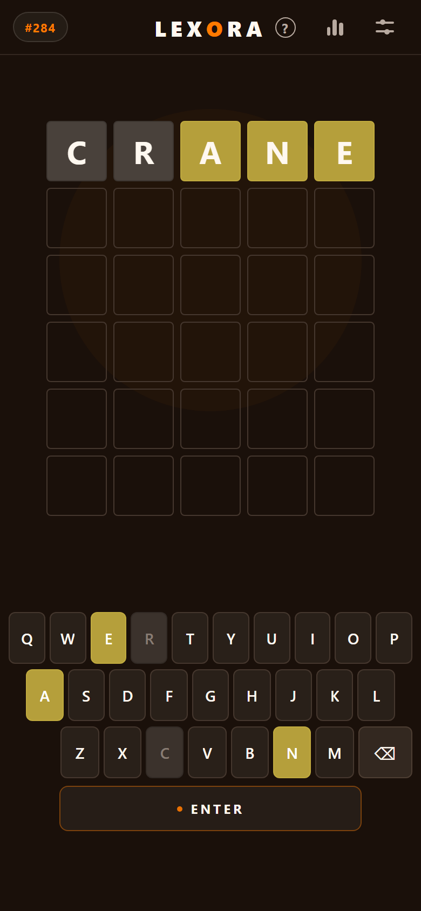
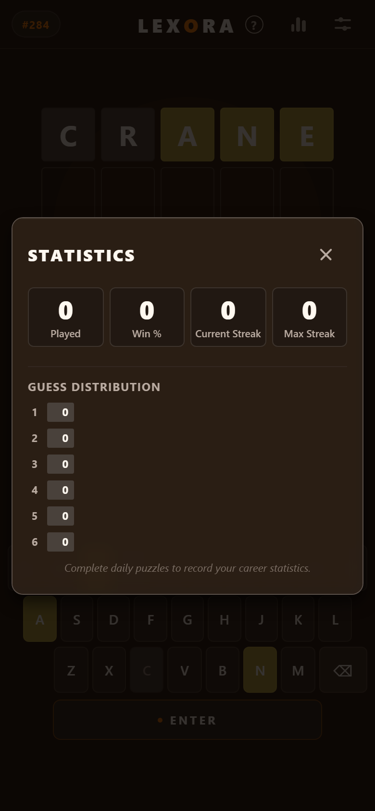
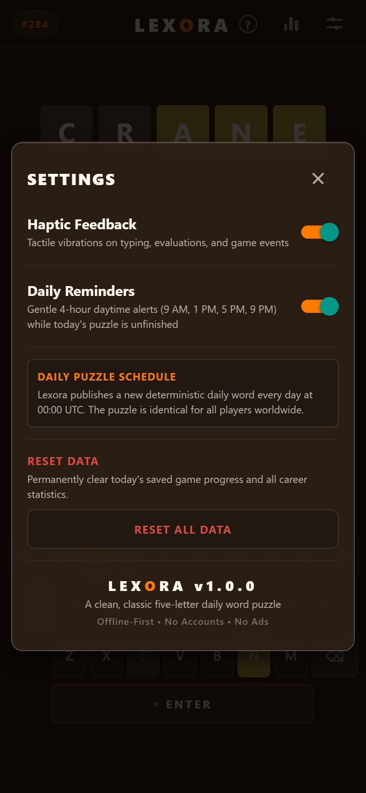

<div align="center">

  

  # L E X O R A

  **A refined, offline-first five-letter daily word puzzle crafted with React Native, Expo, and TypeScript.**

  [](https://github.com/Nairy1729/Lexora/releases/latest)
  [](https://github.com/Nairy1729/Lexora)
  [](https://expo.dev)
  [](https://github.com/Nairy1729/Lexora)
  [](https://github.com/Nairy1729/Lexora)

  <br />

  <p align="center">
    <a href="https://github.com/Nairy1729/Lexora/releases/download/v1.0.0/Lexora-v1.0.0.apk">
      
    </a>
    &nbsp;&nbsp;
    <a href="https://expo.dev/accounts/nairy/projects/lexora/builds/8a9a9e9a-6bc0-4904-9f6c-d065262952c9">
      
    </a>
  </p>

</div>

---

## 📸 Visual Showcase

<div align="center">
  <table>
    <tr>
      <td align="center"><b>Clean Board</b></td>
      <td align="center"><b>Letter Evaluation</b></td>
      <td align="center"><b>Career Statistics</b></td>
      <td align="center"><b>Preferences & Controls</b></td>
    </tr>
    <tr>
      <td></td>
      <td></td>
      <td></td>
      <td></td>
    </tr>
  </table>
</div>

---

## ✨ Highlights & Features

### 📅 Deterministic Daily Puzzle
- Synchronized globally at **00:00 UTC** — every player worldwide solves the exact same daily puzzle.
- Powered by a canonical **2,311-word solution pool** guaranteeing **6.3+ years** of unique, non-repeating challenges.
- Backward-compatible historical index preservation ensuring identical puzzle solutions for past dates.

### 🎯 Practice Mode Isolation
- Unlimited standalone replay sessions for skill building.
- **Strict dual-session isolation**: In-progress guesses, boards, and outcomes in Practice Mode never leak into Daily Mode, distort streaks, or alter career statistics.

### 🎨 Dark-Glass Editorial Visual Identity
- Bespoke warm dark espresso (`#1A100A`) palette with subtle ambient glow and restrained amber accents (`#FF7A00`).
- Mathematical and optical header centering across all screen sizes.
- Uniform 1.5px tile borders preventing subpixel typing jitter.
- Fully audited for **WCAG 2.1 AAA** contrast compliance.

### ⌨️ Ergonomic Keyboard & Standalone ENTER
- Three-row letter layout with Backspace integrated into Row 3.
- Centered, wide **`• ENTER` button** positioned below the keyboard with a distinct tactile signature.
- Native physical keyboard event listener with modifier key suppression for seamless web testing.

### 🔒 100% Offline & Privacy-First
- Zero telemetry, zero analytics tracking, no user accounts, and zero advertising SDKs.
- Complete **12,947-word accepted vocabulary** bundled locally in a high-speed \(O(1)\) lookup set.
- Storage encryption boundaries and JSON sanitization preventing prototype pollution or payload injection.

### 📊 Career Analytics & Guess Distribution
- Persistent tracking of games played, win rate percentage, current streak, and maximum streak.
- Interactive 6-tier guess distribution histogram.
- Spoiler-safe result card generation for sharing on social platforms.

### 🔔 Smart Daytime Reminders
- Non-intrusive 4-hour daytime reminder notifications (9 AM, 1 PM, 5 PM, 9 PM) if today's daily puzzle is unsolved.
- Automatically and idempotently purged the moment today's puzzle is completed or toggled off in settings.
- Android 13+ runtime notification permissions support with pure monochrome status-bar icons.

---

## 📱 Quick Download & Installation

### Option 1: Direct APK Download
1. Download [**Lexora-v1.0.0.apk**](https://github.com/Nairy1729/Lexora/releases/download/v1.0.0/Lexora-v1.0.0.apk) from the [Releases](https://github.com/Nairy1729/Lexora/releases) tab.
2. Open the `.apk` file on your Android handset and grant permission to install from your browser or file manager.

### Option 2: Install via Expo EAS
Open the [EAS Build Page](https://expo.dev/accounts/nairy/projects/lexora/builds/8a9a9e9a-6bc0-4904-9f6c-d065262952c9) directly on your Android phone's browser or scan the QR code to install.

### Option 3: ADB Sideload (Developers)
```bash
adb install -r "Lexora-v1.0.0.apk"
```

---

## 🛠️ Architecture & Tech Stack

```
Lexora/
├── assets/                    # Production icons, splash screens, and notification assets
│   └── screenshots/           # High-resolution visual showcase captures
├── src/
│   ├── components/
│   │   ├── common/            # AppButton, IconButton, AppLaunchScreen
│   │   ├── game/              # GameHeader, GameGrid, GameTile, GameKeyboard, GameOverPanel
│   │   └── modals/            # HelpModal, StatsModal, SettingsModal
│   ├── constants/             # Design system theme tokens, colors, typography, dictionary
│   ├── engine/                # Evaluation algorithms, daily selector, input normalizer
│   │   └── __tests__/         # 152 automated unit, regression, and VAPT security tests
│   ├── hooks/                 # Web keyboard input listeners, lifecycle hooks
│   ├── security/              # Storage sanitizers, payload validators
│   ├── storage/               # AsyncStorage persistence adapters
│   └── utils/                 # Daytime notification scheduler, countdown timers
├── scripts/                   # Release gate verifier, asset generators, size analyzers
├── App.tsx                    # Root coordinator and launch sequence orchestrator
└── app.json                   # Expo SDK 52 application configuration & plugins
```

- **Runtime**: [React Native 0.86.3](https://reactnative.dev/) with [Hermes Engine](https://hermesengine.dev/)
- **Framework**: [Expo SDK 52](https://docs.expo.dev/)
- **Language**: [TypeScript 5.8](https://www.typescriptlang.org/) (Strict Mode)
- **Animations**: [React Native Reanimated 4](https://docs.swmansion.com/react-native-reanimated/)
- **State & Storage**: [@react-native-async-storage/async-storage](https://react-native-async-storage.github.io/async-storage/)
- **Sensory & Haptics**: `expo-haptics`, `expo-notifications`, `expo-splash-screen`

---

## 🚀 Local Development

### 1. Prerequisites
- [Node.js](https://nodejs.org/) (v18.0 or later)
- [npm](https://www.npmjs.com/) or [bun](https://bun.sh/)
- Android Studio / Android SDK (for native Android builds)

### 2. Installation
```bash
# Clone the repository
git clone https://github.com/Nairy1729/Lexora.git
cd Lexora

# Install dependencies
npm install
```

### 3. Running the App
```bash
# Start development server
npx expo start

# Run directly on web browser
npx expo start --web

# Run on connected Android device / emulator
npx expo start --android
```

### 4. Running Tests & Quality Verification
```bash
# Run the complete test suite (152 tests across 21 suites)
npm test

# Run TypeScript strict typecheck
npm run typecheck

# Run Expo / ESLint linter
npm run lint

# Run Expo Doctor dependency and config diagnostics
npm run doctor

# Run the independent Release Gate verification
python scripts/verify_release_gate.py
```

---

## 📦 Package Optimization & Size Profile

Lexora's Android production release is configured with ProGuard / R8 code shrinking and native architecture filtering:

| Metric | Measurement |
| :--- | :--- |
| **Download APK Size** | **36.15 MB** (37.9 MB total uncompressed zip) |
| **Installed Device Footprint** | ~40.8 MB |
| **Native Architecture Libraries** | `arm64-v8a` + `armeabi-v7a` |
| **Bytecode Compiler** | Hermes Bytecode Optimization |
| **Network Requests** | 0 bytes (Zero network dependencies) |

---

## 📜 Dictionary Attribution & Licensing

- **Solution Word Pool**: Canonical 5-letter common English lexicon adapted from public-domain Wordle research archives and Grant Sanderson (3Blue1Brown) (MIT License).
- **Accepted Guess Vocabulary**: Derived from ENABLE (Enhanced North American Benchmark Lexicon) and SCOWL (Spell Checking Oriented Word Lists) (Public Domain / MIT License).
- For complete licensing terms and copyright details, refer to [`ATTRIBUTION.md`](ATTRIBUTION.md).

---

## 📄 License

This project is licensed under the [MIT License](LICENSE).
